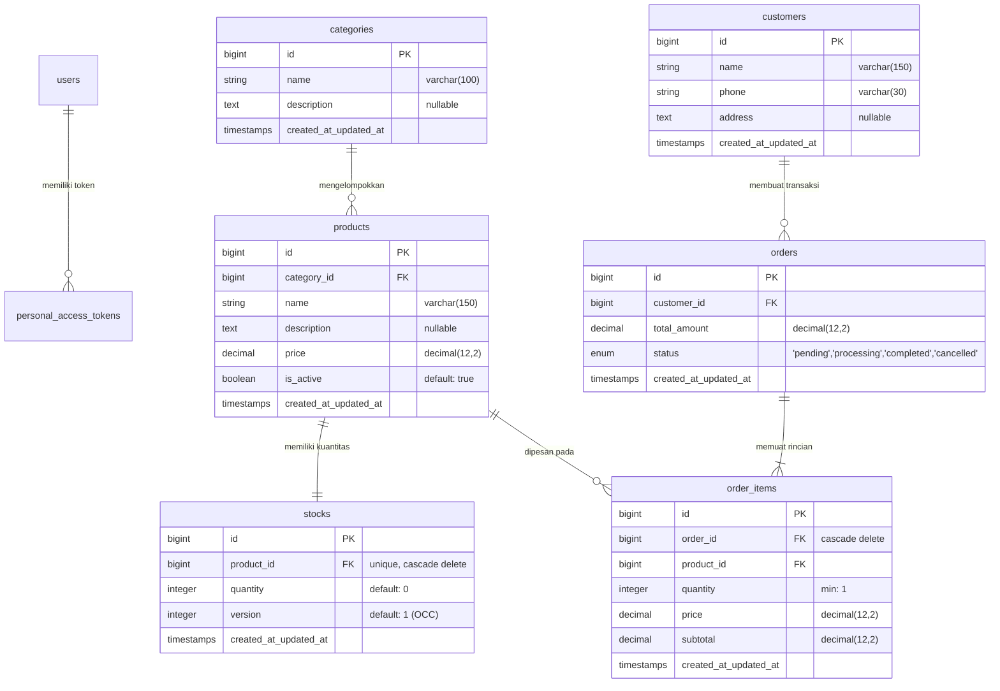

# 🛒 UMKMHub API

> **Platform REST API backend untuk manajemen katalog produk dan operasional pesanan UMKM.**  
> Dibangun dengan arsitektur berlapis (*layered architecture*) di atas Laravel 13 dan PHP 8.3+, mengimplementasikan *Optimistic Concurrency Control* (OCC) pada kuantitas stok, kontrak formal OpenAPI 3.1.0, dan autentikasi stateless berbasis Laravel Sanctum.

<div align="center">

[](https://www.php.net/)
[](https://laravel.com/)
[](https://laravel.com/docs/sanctum)
[](https://vitejs.dev/)
[](https://tailwindcss.com/)
[](https://www.sqlite.org/)
[](https://phpunit.de/)
[](https://www.openapis.org/)
<!--[](composer.json)-->

</div>

---

## 📑 Daftar Isi

- [Tentang Proyek](#-tentang-proyek)
- [Fitur Utama](#-fitur-utama)
- [Teknologi yang Digunakan](#-teknologi-yang-digunakan)
- [Persyaratan Sistem](#-persyaratan-sistem)
- [Struktur Direktori](#-struktur-direktori)
- [Arsitektur Aplikasi](#-arsitektur-aplikasi)
- [Instalasi dan Konfigurasi](#-instalasi-dan-konfigurasi)
- [Konfigurasi Environment](#-konfigurasi-environment)
- [Cara Menjalankan Aplikasi](#-cara-menjalankan-aplikasi)
- [Dokumentasi API](#-dokumentasi-api)
- [Database dan Data Model](#-database-dan-data-model)
- [Testing dan Quality Assurance](#-testing-dan-quality-assurance)
- [Keamanan](#-keamanan)
- [Troubleshooting](#-troubleshooting)
- [Deployment](#-deployment)
- [Kontribusi](#-kontribusi)
- [Lisensi](#-lisensi)
- [Tim Pengembang dan Referensi](#-tim-pengembang-dan-referensi)
- [Catatan Tambahan dan Roadmap](#-catatan-tambahan-dan-roadmap)

---

## 📖 Tentang Proyek

**UMKMHub API** adalah layanan *backend web service* berbasis RESTful API yang dirancang untuk mendukung transformasi digital pelaku UMKM (Usaha Mikro, Kecil, dan Menengah) dalam mengelola katalog produk, persediaan barang (*inventory*), data pelanggan, serta pemrosesan transaksi pesanan secara efisien dan andal.

### Latar Belakang & Masalah yang Diselesaikan

Pada ekosistem operasional UMKM konvensional, pencatatan transaksi dan pemantauan stok barang sering kali menemui berbagai kendala kritis:
1. **Inkonsistensi & Kerusakan Data Stok (*Lost Updates & Race Conditions*):** Ketika dua transaksi atau admin memperbarui kuantitas produk yang sama secara simultan, pembaruan terakhir menimpa pembaruan sebelumnya tanpa peringatan. Masalah ini diselesaikan melalui penerapan **Optimistic Concurrency Control (OCC)** berbasis kolom `version`.
2. **Ketiadaan Kontrak API Terpadu:** Kerentanan integrasi antara pengembang backend, frontend web, aplikasi mobile, dan pengujian otomatis. Proyek ini mengadopsi metodologi **Design-First** dengan kontrak spesifikasi **OpenAPI 3.1.0** sebagai *single source of truth*.
3. **Pencampuran Logika Bisnis (*Spaghetti Architecture*):** Banyak backend PHP menempatkan seluruh validasi dan manipulasi database langsung di dalam file controller. Proyek ini memisahkan tanggung jawab secara tegas menggunakan **Layered Architecture** (*Controller* ➔ *Form Request* ➔ *Service* ➔ *Eloquent Model* ➔ *API Resource*).

### Sasaran Pengguna
- **Admin & Pengelola UMKM:** Memantau ketersediaan stok, mengelola daftar kategori, mendaftarkan katalog produk, dan memperbarui status pesanan.
- **Klien Pelanggan (Web/Mobile Apps):** Menjelajah katalog etalase, mencari produk, mendaftar sebagai pelanggan, melakukan transaksi checkout, serta melihat riwayat pesanan.

---

## ✨ Fitur Utama

Seluruh fitur di bawah ini telah diimplementasikan pada kode sumber:

| Modul | Komponen Teknis | Deskripsi Fungsional |
|---|---|---|
| **Autentikasi & Profil** | `AuthController`, Sanctum | Penerbitan token autentikasi Bearer (`auth-token`) dengan masa berlaku 86.400 detik (24 jam), penutupan sesi (*logout* via token revocation), dan inspeksi profil aktif (`/me`). |
| **Kategori Produk** | `CategoryController`, `CategoryService` | Operasi CRUD master data kategori lengkap dengan proteksi penghapusan (*restrict delete*) jika kategori masih menaungi produk aktif. |
| **Katalog Produk** | `ProductController`, `ProductService` | CRUD katalog dengan filter multi-kriteria (`category_id`, status `is_active`), pencarian teks bebas nama & deskripsi (`q`), penyortiran dinamis (`sort`), paginasi berbasis halaman, serta inisialisasi entitas stok otomatis. |
| **Kontrol Stok (OCC)** | `StockController`, `StockService` | Monitoring stok dengan filter batas minimum (`low_stock <= 10`) dan pembaruan stok berbasis mekanisme *Optimistic Locking* dengan validasi versi kolom `version`. |
| **Manajemen Pelanggan** | `CustomerController`, `CustomerService` | Pendaftaran pelanggan baru, inspeksi profil pelanggan, dan pembacaan riwayat pesanan milik pelanggan (*nested resource* `/customers/{id}/orders`). |
| **Checkout Pesanan Atomik** | `OrderController`, `OrderService` | Transaksi pemesanan multi-item di dalam `DB::transaction()` atomik, verifikasi ketersediaan stok real-time dengan penguncian baris (`lockForUpdate()`), pemotongan kuantitas, dan penambahan versi stok. |
| **Siklus Hidup Pesanan** | `OrderController`, `OrderService` | Pembaruan status pesanan non-CRUD melalui endpoint terarah `PATCH /orders/{id}/status` (`pending` ➔ `processing` ➔ `completed` / `cancelled`). |
| **Penanganan Error Terpadu** | `bootstrap/app.php`, `StockConflictException` | Tanggapan error JSON terstandarisasi untuk status `401 Unauthorized`, `404 Not Found`, `405 Method Not Allowed`, `409 Conflict`, dan `422 Unprocessable Content` tanpa mengekspos stack trace sensitif. |
| **Dokumentasi OpenAPI & Scramble** | `Dedoc\Scramble`, `docs/openapi.yaml` | Antarmuka interaktif OpenAPI bawaan yang dapat diakses langsung pada `/docs/api` serta kontrak statis OpenAPI 3.1.0 dan Postman Collection. |

---

## 🛠️ Teknologi yang Digunakan

Berikut adalah rincian tumpukan teknologi (*tech stack*) yang terverifikasi dari file dependensi (`composer.json` dan `package.json`):

### 1. Backend & Runtime

| Teknologi | Versi | Peran dalam Proyek |
|---|---|---|
|  | `^8.3` (Diuji pada PHP 8.5.6) | Bahasa pemrograman utama backend |
|  | `^13.17` | Kerangka kerja MVC backend & routing API |
|  | `^4.0` | Autentikasi API berbasis Personal Access Token (Bearer) |
|  | `^3.0` | CLI REPL interaktif untuk debugging Eloquent |
|  | `^0.13.52` | Generator dokumentasi API OpenAPI interaktif otomatis |

### 2. Frontend & Tooling Aset

| Teknologi | Versi | Peran dalam Proyek |
|---|---|---|
|  | `^8.0.0` | Bundler dan dev-server aset frontend |
|  | `^4.0.0` | Framework utility CSS via `@tailwindcss/vite` |
|  | `^3.1` | Integrasi build view Blade dengan Vite bundler |
| [](https://redocly.com/) | `^2.71.0` | Linter dan validator berkas spesifikasi OpenAPI |

### 3. Basis Data & Pengujian

| Teknologi | Versi | Peran dalam Proyek |
|---|---|---|
|  | Default Built-in | Penyimpanan data lokal default & testing in-memory |
|  | `^12.5.12` | Framework automated unit & feature testing |
|  | `^1.27` | Code style checker & formatter standar PSR-12 |
|  | `^1.23` | Pembangkit data tiruan (*dummy data*) seeder & factory |

---

## 💻 Persyaratan Sistem

Sebelum melakukan instalasi dan menjalankan proyek, pastikan mesin pengembang memenuhi prasyarat runtime berikut:

| Perangkat Lunak | Versi Minimal | Perintah Pengecekan |
|---|---|---|
| **PHP** | `>= 8.3.0` | `php -v` |
| **Ekstensi PHP Wajib** | `pdo_sqlite`, `sqlite3`, `mbstring`, `openssl`, `tokenizer`, `xml`, `ctype`, `json`, `bcmath` | `php -m` |
| **Composer** | `>= 2.2.0` | `composer --version` |
| **Node.js** | `>= 20.0.0` (Direkomendasikan LTS) | `node -v` |
| **npm** | `>= 10.0.0` | `npm -v` |
| **Git** | `>= 2.30.0` | `git --version` |

> [!NOTE]
> Database default dikonfigurasi menggunakan **SQLite**, sehingga Anda tidak perlu menginstal atau menjalankan daemon MySQL/PostgreSQL tambahan pada lingkungan pengembangan lokal. Pastikan ekstensi `pdo_sqlite` telah diaktifkan pada file `php.ini`.

---

## 📁 Struktur Direktori

Berikut adalah pohon direktori utama proyek beserta penjelasan fungsi setiap folder:

```text
UMKMhub/
├── app/
│   ├── Exceptions/
│   │   └── StockConflictException.php        # Custom Exception untuk konflik versi stok & relasi data (HTTP 409)
│   ├── Http/
│   │   ├── Controllers/
│   │   │   ├── Controller.php                # Base Controller Laravel
│   │   │   └── Api/V1/                       # Controller REST API v1
│   │   │       ├── AuthController.php        # Otentikasi Sanctum (login, logout, profil /me)
│   │   │       ├── CategoryController.php    # CRUD Master Kategori Produk
│   │   │       ├── CustomerController.php    # Registrasi pelanggan & nested order history
│   │   │       ├── OrderController.php       # Pemrosesan checkout & update status pesanan
│   │   │       ├── ProductController.php     # Katalog produk, filter, sorting, dan paginasi
│   │   │       └── StockController.php       # Monitoring kuantitas stok & update OCC
│   │   ├── Requests/                         # Lapisan Validasi Form Request per Domain
│   │   │   ├── Auth/LoginRequest.php
│   │   │   ├── Category/                     # StoreCategoryRequest, UpdateCategoryRequest
│   │   │   ├── Customer/StoreCustomerRequest.php
│   │   │   ├── Order/                        # StoreOrderRequest, UpdateOrderStatusRequest
│   │   │   ├── Product/                      # IndexProductRequest, StoreProductRequest, UpdateProductRequest
│   │   │   └── Stock/                        # IndexStockRequest, UpdateStockRequest
│   │   └── Resources/                        # Lapisan Transformasi JSON API Resource
│   │       ├── CategoryResource.php
│   │       ├── CustomerResource.php
│   │       ├── OrderResource.php
│   │       ├── ProductResource.php
│   │       └── StockResource.php
│   ├── Models/                               # Eloquent Data Models
│   │   ├── Category.php                      # Model Kategori
│   │   ├── Customer.php                      # Model Pelanggan
│   │   ├── Order.php                         # Model Header Pesanan
│   │   ├── OrderItem.php                     # Model Item Rincian Pesanan
│   │   ├── Product.php                       # Model Produk
│   │   ├── Stock.php                         # Model Stok & Versioning
│   │   └── User.php                          # Model Pengguna/Admin
│   ├── Providers/
│   │   └── AppServiceProvider.php            # Service Provider Utama
│   └── Services/                             # Lapisan Logika Bisnis & Transaksi Database
│       ├── CategoryService.php               # Logika isolasi relasi kategori
│       ├── CustomerService.php               # Logika agregasi pesanan pelanggan
│       ├── OrderService.php                  # Checkout transaksi atomik & decrement stok
│       ├── ProductService.php                # Filter query katalog & auto-inisialisasi stok
│       └── StockService.php                  # Validasi versi OCC (Optimistic Concurrency Control)
├── bootstrap/
│   ├── app.php                               # Konfigurasi routing API, middleware, & global JSON exception
│   └── providers.php
├── config/                                   # File konfigurasi bawaan Laravel (app, auth, database, sanctum, dll.)
├── database/
│   ├── factories/
│   │   └── UserFactory.php
│   ├── migrations/                           # Skema 10 tabel database relasional
│   │   ├── 0001_01_01_000000_create_users_table.php
│   │   ├── 0001_01_01_000001_create_cache_table.php
│   │   ├── 0001_01_01_000002_create_jobs_table.php
│   │   ├── 2026_10_04_071920_create_personal_access_tokens_table.php
│   │   ├── 2026_10_24_091120_create_categories_table.php
│   │   ├── 2026_10_24_091127_create_products_table.php
│   │   ├── 2026_10_24_091142_create_stocks_table.php
│   │   ├── 2026_10_24_091153_create_customers_table.php
│   │   ├── 2026_10_24_091204_create_orders_table.php
│   │   └── 2026_10_24_091212_create_order_items_table.php
│   └── seeders/
│       └── DatabaseSeeder.php                # Seeding data dummy awal (admin, kategori, produk, stok)
├── docs/                                     # Dokumentasi Spesifikasi API
│   ├── api-design.md                         # Dokumen rancangan endpoint matrix & kueri
│   ├── openapi.yaml                          # Kontrak resmi OpenAPI 3.1.0 (Single Source of Truth)
│   └── postman/
│       ├── collection.json                   # Koleksi Postman siap pakai
│       └── contract-compliance.md            # Laporan kepatuhan terhadap kontrak API
├── routes/
│   ├── api.php                               # Definisi seluruh rute API v1
│   ├── console.php                           # Definisi perintah artisan konsol
│   └── web.php                               # Rute fallback web
├── tests/
│   ├── Feature/
│   │   ├── ExampleTest.php
│   │   ├── ProductApiTest.php                # Pengujian feature CRUD produk & paginasi
│   │   └── ProductWeek3ApiTest.php           # Pengujian komprehensif Auth, OCC, Checkout, & Error Handling
│   └── Unit/
│       └── ExampleTest.php
├── .env.example                              # Template variabel lingkungan
├── artisan                                   # CLI entry point Laravel
├── composer.json                             # Dependensi PHP & skrip automasi Composer
├── package.json                              # Dependensi JavaScript & skrip Vite
├── phpunit.xml                               # Konfigurasi automated testing (SQLite memory)
└── vite.config.js                            # Konfigurasi bundler Vite & Tailwind v4
```

---

## 🏛️ Arsitektur Aplikasi

Proyek menerapkan **Layered Architecture (Arsitektur Berlapis)** untuk memisahkan tanggung jawab kode secara modular, memudahkan pengujian unit/fitur, serta mencegah penumpukan logika di Controller:

```
[ Klien HTTP / Postman / Frontend ]
               │
               ▼  (HTTP Request application/json)
      [ routes/api.php ]
               │
               ▼  (Validasi & Sanitasi Data)
     [ Form Request Layer ]
  (StoreOrderRequest, etc.)
               │
               ▼  (Payload Valid)
     [ Controller Layer ]
  (OrderController, etc.)
               │
               ▼  (Pendelegasian Logika Bisnis)
      [ Service Layer ]
   (OrderService, etc.)  ◄── [ Optimistic Concurrency Control / DB Transaction ]
               │
               ▼  (Query & Mutasi Data)
   [ Eloquent Models & DB ]
 (Order, Stock, Product, SQLite)
               │
               ▼  (Format & Serialisasi Data Envelope)
    [ API Resource Layer ]
    (OrderResource, etc.)
               │
               ▼  (HTTP Response 200/201/409/422)
[ Klien Menerima JSON Standar ]
```

### 1. Mekanisme Optimistic Concurrency Control (OCC)
Resource stok (`stocks`) dilengkapi dengan atribut `version`. Saat memperbarui stok melalui `PATCH /api/v1/stocks/{id}`:
1. Klien wajib menyertakan nilai `version` terkini yang dimilikinya.
2. `StockService::updateStock()` memeriksa apakah `stock.version === request.version`.
3. Jika versi cocok, kuantitas diperbarui dan `version` dinaikkan sebesar 1.
4. Jika versi berbeda (data telah diubah klien lain terlebih dahulu), sistem memicu `StockConflictException` yang mengembalikan kode status `409 Conflict` dengan kode error `STOK_VERSION_MISMATCH`.

### 2. Transaksi Checkout Atomik
Pada proses checkout pesanan (`POST /api/v1/orders`), `OrderService::checkout()` menjalankan seluruh alur di dalam blok `DB::transaction()`:
- Setiap item produk diperiksa ketersediaan kuantitas stoknya menggunakan penguncian baris `lockForUpdate()`.
- Jika stok tidak mencukupi, transaksi dibatalkan (*rollback*) seketika dan melempar `StockConflictException` (`409 Conflict`, `INSUFFICIENT_STOCK`).
- Jika stok tersedia, stok dipotong otomatis, versi dinaikkan, header pesanan dibuat, rincian `order_items` disimpan, dan transaksi dikomit secara aman.

---

## 📥 Instalasi dan Konfigurasi

Ikuti langkah-langkah di bawah ini untuk menyiapkan proyek pada lingkungan lokal Anda:

### 1. Kloning Repository
Buka terminal dan lakukan kloning repositori ke komputer lokal Anda:
```bash
git clone <URL_REPOSITORY>
cd "UMKMhub - Copy"
```
*(Ganti `<URL_REPOSITORY>` dengan URL git Anda).*

### 2. Instalasi Dependensi Backend (Composer)
Jalankan instalasi pustaka PHP:
```bash
composer install
```

### 3. Instalasi Dependensi Frontend (npm)
Jalankan instalasi pustaka JavaScript:
```bash
npm install
```

### 4. Konfigurasi Environment File
Salin file template `.env.example` menjadi `.env`:
```bash
# Pada Windows PowerShell:
Copy-Item .env.example .env

# Pada Linux / macOS / Bash:
cp .env.example .env
```

### 5. Generate Application Key
Buat kunci enkripsi aplikasi Laravel:
```bash
php artisan key:generate
```

### 6. Migrasi & Seeding Basis Data
Jalankan migrasi tabel ke basis data SQLite dan isi data awal (*seed*):
```bash
php artisan migrate --seed
```

### 7. Build Aset Frontend
Lakukan kompilasi aset frontend via Vite:
```bash
npm run build
```

> [!TIP]
> Proyek menyediakan perintah pintas otomatis melalui Composer script:
> ```bash
> composer run setup
> ```
> Perintah di atas secara berurutan menjalankan `composer install`, pembuatan `.env`, generate key, migrasi tabel, `npm install`, dan `npm run build`.

---

## ⚙️ Konfigurasi Environment

Berikut adalah daftar variabel lingkungan (*environment variables*) yang didukung pada berkas `.env.example`:

| Variabel | Fungsi / Deskripsi | Wajib? | Nilai Default / Rekomendasi |
|---|---|---|---|
| `APP_NAME` | Nama aplikasi | Tidak | `UMKMHub` |
| `APP_ENV` | Lingkungan aplikasi running | Ya | `local` (Ubah ke `production` saat rilis) |
| `APP_KEY` | Kunci enkripsi enkripsi string & token | Ya | Dihasilkan via `php artisan key:generate` |
| `APP_DEBUG` | Mode debug (tampilkan stack trace saat error) | Ya | `false` (Wajib `false` di staging/production) |
| `APP_TIMEZONE` | Zona waktu aplikasi | Ya | `Asia/Jakarta` |
| `APP_URL` | Base URL aplikasi | Ya | `http://localhost:8000` |
| `BCRYPT_ROUNDS` | Bobot hash password (cost factor) | Tidak | `12` |
| `LOG_CHANNEL` | Saluran pencatatan log sistem | Ya | `stack` |
| `LOG_LEVEL` | Level minimum pencatatan log | Tidak | `debug` (Gunakan `error` pada production) |
| `DB_CONNECTION` | Driver koneksi database | Ya | `sqlite` (`mysql` / `pgsql` untuk production) |
| `DB_HOST` | Host database server | Khusus MySQL/PgSQL | `127.0.0.1` |
| `DB_PORT` | Port database server | Khusus MySQL/PgSQL | `3306` (MySQL) / `5432` (Postgres) |
| `DB_DATABASE` | Nama basis data | Khusus MySQL/PgSQL | `umkmhub` |
| `DB_USERNAME` | Nama pengguna database | Khusus MySQL/PgSQL | `root` |
| `DB_PASSWORD` | Kata sandi database | Khusus MySQL/PgSQL | *(Dikosongkan jika lokal)* |
| `SESSION_DRIVER` | Tempat penyimpanan sesi HTTP | Ya | `database` |
| `CACHE_STORE` | Driver penyimpanan cache | Ya | `database` (Dapat diubah ke `redis`) |
| `QUEUE_CONNECTION` | Driver antrean proses background (*queue*) | Ya | `database` |

---

## 🚀 Cara Menjalankan Aplikasi

### 1. Menjalankan Server Development Terintegrasi
Cara paling ringkas adalah menggunakan skrip terpadu dari Composer yang mengaktifkan server Laravel dan Vite secara simultan:
```bash
composer run dev
```

### 2. Menjalankan Server PHP & Vite Secara Mandiri
Jika ingin menjalankan layanan pada terminal terpisah:
- **Terminal 1 (Backend API Server):**
  ```bash
  php artisan serve
  # Server berjalan pada: http://127.0.0.1:8000
  ```
- **Terminal 2 (Vite HMR Development Server):**
  ```bash
  npm run dev
  # Memantau perubahan CSS/JS pada port lokal Vite
  ```

### 3. Membuka Dokumentasi API Interaktif
Setelah server aktif, Anda dapat langsung menguji dan membaca dokumentasi OpenAPI interaktif yang digenerate oleh Scramble:
- URL UI OpenAPI: **`http://127.0.0.1:8000/docs/api`**
- URL Spesifikasi JSON: **`http://127.0.0.1:8000/docs/api.json`**

---

## 📡 Dokumentasi API

- **Base URL:** `http://127.0.0.1:8000/api/v1`
- **Format Pertukaran Data:** Seluruh request dan response menggunakan header `Content-Type: application/json` dan `Accept: application/json`.
- **Standar Envelope Data:** Respons sukses selalu dibungkus di dalam key `"data"`.

### Matriks Endpoint REST API v1 (22 Rute)

| Grup | Method | Endpoint Path | Nama Route | Keterangan |
|---|---|---|---|---|
| **Auth** | `POST` | `/api/v1/auth/login` | `v1.auth.login` | Autentikasi kredensial email & password, menghasilkan Bearer token |
| **Auth** | `POST` | `/api/v1/auth/logout` | `v1.auth.logout` | Revokasi access token aktif |
| **Auth** | `GET` | `/api/v1/me` | `v1.auth.me` | Mengambil data identitas pengguna yang sedang terotentikasi |
| **Categories** | `GET` | `/api/v1/categories` | `v1.categories.index` | Daftar seluruh kategori produk |
| **Categories** | `POST` | `/api/v1/categories` | `v1.categories.store` | Menambah kategori baru |
| **Categories** | `GET` | `/api/v1/categories/{category}` | `v1.categories.show` | Mengambil detail kategori spesifik |
| **Categories** | `PUT/PATCH` | `/api/v1/categories/{category}` | `v1.categories.update` | Memperbarui nama/deskripsi kategori |
| **Categories** | `DELETE` | `/api/v1/categories/{category}` | `v1.categories.destroy` | Menghapus kategori (gagal jika terdapat produk terkait) |
| **Products** | `GET` | `/api/v1/products` | `v1.products.index` | Daftar katalog berpaginasi (dukungan filter, search, sort) |
| **Products** | `POST` | `/api/v1/products` | `v1.products.store` | Mendaftarkan produk baru & auto-create stok awal (`version: 1`) |
| **Products** | `GET` | `/api/v1/products/{product}` | `v1.products.show` | Mengambil rincian produk beserta stok dan kategori |
| **Products** | `PUT/PATCH` | `/api/v1/products/{product}` | `v1.products.update` | Memperbarui atribut produk (nama, harga, status, dll.) |
| **Products** | `DELETE` | `/api/v1/products/{product}` | `v1.products.destroy` | Menghapus produk (gagal jika sudah pernah dipesan) |
| **Stocks** | `GET` | `/api/v1/stocks` | `v1.stocks.index` | Monitoring stok produk (opsi filter `low_stock=true`) |
| **Stocks** | `PATCH` | `/api/v1/stocks/{stock}` | `v1.stocks.update` | Update kuantitas stok dengan verifikasi nomor `version` (OCC) |
| **Customers** | `GET` | `/api/v1/customers` | `v1.customers.index` | Menampilkan seluruh daftar pelanggan |
| **Customers** | `POST` | `/api/v1/customers` | `v1.customers.store` | Mendaftarkan pelanggan baru |
| **Customers** | `GET` | `/api/v1/customers/{customer}` | `v1.customers.show` | Menampilkan detail spesifik profil pelanggan |
| **Customers** | `GET` | `/api/v1/customers/{customer}/orders` | `v1.customers.orders` | Riwayat pesanan milik pelanggan tertentu (*nested resource*) |
| **Orders** | `POST` | `/api/v1/orders` | `v1.orders.store` | Melakukan checkout pesanan baru (atomik & decrement kuantitas stok) |
| **Orders** | `GET` | `/api/v1/orders/{order}` | `v1.orders.show` | Menampilkan detail pesanan, pelanggan, dan daftar item produk |
| **Orders** | `PATCH` | `/api/v1/orders/{order}/status` | `v1.orders.status` | Mengubah status pesanan (`pending`, `processing`, `completed`, `cancelled`) |

---

### Contoh Payload & Respons Endpoint Utama

#### 1. Login Autentikasi
```http
POST /api/v1/auth/login
Content-Type: application/json

{
  "email": "admin@umkmhub.id",
  "password": "password123"
}
```
**Respons Berhasil (`200 OK`):**
```json
{
  "data": {
    "token_type": "Bearer",
    "access_token": "1|qWb2...c3d4",
    "expires_in": 86400
  }
}
```

#### 2. Menampilkan Katalog Produk dengan Kueri Filter & Sort
```http
GET /api/v1/products?category_id=1&is_active=1&q=keripik&sort=-price&per_page=10&page=1
```
**Respons Berhasil (`200 OK`):**
```json
{
  "data": [
    {
      "id": 1,
      "name": "Keripik Tempe Renyah",
      "description": "Keripik tempe gurih renyah kemasan 200 gram khas Malang",
      "price": 15000,
      "category": {
        "id": 1,
        "name": "Makanan Ringan"
      },
      "is_active": true,
      "created_at": "2026-10-24T09:11:27.000000Z"
    }
  ],
  "links": {
    "first": "http://127.0.0.1:8000/api/v1/products?page=1",
    "last": "http://127.0.0.1:8000/api/v1/products?page=1",
    "prev": null,
    "next": null
  },
  "meta": {
    "current_page": 1,
    "per_page": 10,
    "total": 1,
    "last_page": 1
  }
}
```

#### 3. Checkout Pesanan Baru
```http
POST /api/v1/orders
Content-Type: application/json

{
  "customer_id": 1,
  "items": [
    {
      "product_id": 1,
      "quantity": 2
    }
  ]
}
```
**Respons Berhasil (`201 Created` - dengan Header `Location: http://127.0.0.1:8000/api/v1/orders/1`):**
```json
{
  "data": {
    "id": 1,
    "customer_id": 1,
    "total_amount": 30000,
    "status": "pending",
    "items": [
      {
        "id": 1,
        "product_id": 1,
        "quantity": 2,
        "price": 15000,
        "subtotal": 30000
      }
    ],
    "created_at": "2026-10-30T00:34:00.000000Z"
  }
}
```

#### 4. Update Stok dengan Optimistic Concurrency Control
```http
PATCH /api/v1/stocks/1
Content-Type: application/json

{
  "quantity": 60,
  "version": 1
}
```
**Respons Berhasil (`200 OK`):**
```json
{
  "data": {
    "id": 1,
    "product_id": 1,
    "quantity": 60,
    "version": 2,
    "updated_at": "2026-10-30T00:35:10.000000Z"
  }
}
```
**Respons Gagal / Konflik Versi (`409 Conflict`):**
```json
{
  "code": "STOK_VERSION_MISMATCH",
  "message": "Stok telah diperbarui oleh pengguna lain. Silakan muat ulang data terbaru."
}
```

---

## 🗄️ Database dan Data Model

Basis data dirancang dengan pemodelan relasional yang efisien dan normalisasi data yang tepat:



### Data Awal Seeding (`DatabaseSeeder.php`)
Ketika mengeksekusi `php artisan db:seed`, data awal berikut secara otomatis diinjeksi:
- **Akun Admin:** `admin@umkmhub.id` / password: `password123`
- **Kategori:** *Makanan Ringan* dan *Minuman*
- **Produk:** *Keripik Tempe Renyah* (Rp 15.000) dan *Kopi Robusta Dampit 250g* (Rp 35.000)
- **Stok:** Masing-masing berstatus 50 dan 30 unit dengan `version: 1`
- **Pelanggan:** *Budi Santoso* (081234567890)

---

## 🧪 Testing dan Quality Assurance

Proyek ini telah dilengkapi dengan suite pengujian otomatis komprehensif menggunakan **PHPUnit 12** yang memanfaatkan basis data SQLite in-memory (`:memory:`) sehingga proses pengujian berjalan sangat cepat dan tidak mengotori database development.

### Menjalankan Automated Test
Eksekusi pengujian dapat dijalankan melalui skrip Composer atau perintah Artisan:
```bash
# Melalui script composer (membersihkan cache konfigurasi sebelum test):
composer run test

# Langsung melalui Artisan:
php artisan test
```

### Hasil Verifikasi Eksekusi Nyata
Pengujian telah dieksekusi secara nyata pada lingkungan proyek dengan hasil verifikasi berikut:
```text
PHPUnit 12.5.12 by Sebastian Bergmann and contributors.
Runtime:       PHP 8.5.6
Configuration: phpunit.xml

   PASS  Tests\Unit\ExampleTest
   ✓ that true is true

   PASS  Tests\Feature\ExampleTest
   ✓ the application returns a successful response

   PASS  Tests\Feature\ProductApiTest
   ✓ can get all products with pagination
   ✓ rejects pagination exceeding max limit
   ✓ rejects invalid sort parameter
   ✓ can create new product
   ✓ can get product detail
   ✓ can update product partially
   ✓ can delete product
   ✓ returns 404 when product not found

   PASS  Tests\Feature\ProductWeek3ApiTest
   ✓ auth login returns valid token structure
   ✓ auth login rejects invalid credentials
   ✓ category crud operations
   ✓ customer registration
   ✓ stocks monitoring list
   ✓ stock update with optimistic locking and conflict
   ✓ order checkout successful and decrements stock
   ✓ order checkout fails when stock insufficient
   ✓ customer orders returns paginated list
   ✓ global exception handling json responses

Tests:    20 passed (114 assertions)
Duration: ~0.80s
```

### Pemeriksaan Standar Gaya Kode (Linting via Pint)
Pemeriksaan gaya penulisan kode PHP berbasis PSR-12 dapat diverifikasi menggunakan Laravel Pint:
```bash
./vendor/bin/pint --test
```
*Hasil eksekusi: Seluruh file kode sumber telah sesuai dengan standar konvensi (`{"tool":"pint","result":"passed"}`).*

---

## 🔒 Keamanan

Aplikasi mengimplementasikan praktik keamanan rekayasa perangkat lunak berikut:
1. **Autentikasi Stateless:** Laravel Sanctum mengamankan akses API melalui header Bearer Token yang terenkripsi SHA-256 di basis data (`personal_access_tokens`).
2. **Perlindungan Terhadap Mass Assignment:** Seluruh Eloquent Model menggunakan atribut `$fillable` secara ketat untuk mencegah injeksi kolom yang tidak sah.
3. **Validasi Input Terpusat:** Menggunakan `FormRequest` untuk memvalidasi tipe data, batas minimal/maksimal, format enum, dan keterikatan relasi *foreign key* (`exists`).
4. **Pencegahan SQL Injection:** Seluruh manipulasi kueri dijalankan menggunakan PDO Prepared Statements melalui Eloquent ORM.
5. **Perlindungan Race Condition:** Menggunakan `lockForUpdate()` pada level transaksi basis data saat checkout untuk mencegah inkonsistensi stok saat lonjakan transaksi simultan (*concurrency safety*).
6. **Exception Shielding:** Modul `bootstrap/app.php` menangkap `NotFoundHttpException` dan `MethodNotAllowedHttpException` agar selalu mengembalikan respons JSON yang bersih tanpa membocorkan path file server, variabel lingkungan, atau stack trace.

---

## 🔧 Troubleshooting

Berikut panduan pemecahan masalah untuk kendala yang kerap dihadapi pada lingkungan instalasi lokal:

| Gejala Masalah | Kemungkinan Penyebab | Tindakan Solusi |
|---|---|---|
| `'vite' is not recognized as an internal or external command` | Folder `node_modules` belum terpasang atau perintah `npm install` dilewati | Jalankan `npm install` pada root direktori proyek, kemudian ulangi `npm run build` |
| HTTP Status `409 Conflict` dengan kode `STOK_VERSION_MISMATCH` | Versi stok yang dikirim oleh klien sudah usang (telah diupdate oleh proses lain) | Lakukan `GET /api/v1/stocks` untuk mengambil nilai `version` terbaru sebelum mengulangi permintaan `PATCH` |
| HTTP Status `409 Conflict` dengan kode `INSUFFICIENT_STOCK` | Kuantitas barang yang diminta saat checkout melebihi sisa stok di database | Turunkan jumlah pesanan atau lakukan restock melalui `PATCH /api/v1/stocks/{id}` |
| HTTP Status `409 Conflict` dengan kode `CATEGORY_IN_USE` / `PRODUCT_HAS_RELATIONS` | Kategori masih memuat produk aktif, atau produk telah tercatat dalam histori pesanan | Hapus atau pindahkan produk turunan terlebih dahulu sebelum menghapus kategori |
| `Driver [sqlite] not supported` | Ekstensi SQLite pada instalasi PHP belum aktif | Buka file `php.ini`, hapus tanda titik koma (`;`) pada baris `extension=pdo_sqlite` dan `extension=sqlite3`, lalu restart terminal/server |
| `No application encryption key has been specified` | Variabel `APP_KEY` pada file `.env` masih kosong | Jalankan perintah `php artisan key:generate` |
| `General error: 1 no such table: ...` | File database SQLite belum dimigrasikan | Jalankan perintah `php artisan migrate` |

---

## 🚢 Deployment

Untuk menerapkan proyek pada server produksi (staging / production), perhatikan panduan operasional berikut:

1. **Konfigurasi Environment Server:**
   - Ubah `APP_ENV=production` dan `APP_DEBUG=false` pada file `.env`.
   - Gunakan basis data berskala produksi seperti **MySQL 8.0+** atau **PostgreSQL 15+** dengan menyesuaikan variabel `DB_CONNECTION=mysql`.
2. **Optimasi Composer & Autoload:**
   ```bash
   composer install --no-dev --optimize-autoloader
   ```
3. **Cache Konfigurasi, Route, dan View:**
   ```bash
   php artisan config:cache
   php artisan route:cache
   php artisan view:cache
   ```
4. **Kompilasi Aset Frontend:**
   ```bash
   npm ci
   npm run build
   ```
5. **Eksekusi Migrasi Aman:**
   ```bash
   php artisan migrate --force
   ```
6. **Web Server Gateway:**
   - Arahkan *Document Root* Nginx atau Apache ke folder `/public` proyek, bukan ke root folder.
   - Pastikan permission folder `storage/` dan `bootstrap/cache/` dapat ditulisi (*writable*) oleh user web server (misalnya `www-data` atau `nginx`).

---

## 🤝 Kontribusi

Kami menyambut kontribusi dan perbaikan dari para pengembang. Silakan ikuti tata cara kontribusi berikut:

1. Lakukan **Fork** pada repositori ini.
2. Buat branch fitur baru dengan konvensi penamaan standar:
   - `feat/nama-fitur` (untuk fitur baru)
   - `fix/nama-bug` (untuk perbaikan kutu/bug)
   - `refactor/nama-modul` (untuk pembersihan struktur kode)
   - `test/nama-pengujian` (untuk penambahan skenario test)
3. Tulis kode yang rapi dan pastikan mematuhi gaya format PSR-12:
   ```bash
   ./vendor/bin/pint
   ```
4. Pastikan seluruh pengujian lolos tanpa kegagalan:
   ```bash
   php artisan test
   ```
5. Lakukan *commit* dengan pesan yang deskriptif dan buat **Pull Request** ke branch `main`.

---

## 📜 Lisensi

- Kode sumber backend aplikasi dilisensikan di bawah lisensi **[MIT License](composer.json)** sebagaimana tercantum dalam metadata `composer.json`.
- Dokumen rancangan kontrak API (**OpenAPI 3.1.0**) dilisensikan di bawah **[Creative Commons Attribution 4.0 International (CC BY 4.0)](https://creativecommons.org/licenses/by/4.0/)** sebagaimana tercantum pada file `docs/openapi.yaml`.

*(Catatan: File teks fisik `LICENSE` mandiri belum dilampirkan secara terpisah pada direktori root).*

---

## 👥 Tim Pengembang dan Referensi

Proyek ini dikembangkan oleh **Kelompok 1 — Mata Kuliah Pemrograman Web Service**:

| Nama Pengembang | Modul Tanggung Jawab Utama |
|---|---|
| **Bara Abiyyi Muslimin** | Products (Penyusun Akhir & Integrasi Katalog) |
| **Afsani Wahyu Mawardi** | Categories (Reviewer Status Code & Modul Kategori) |
| **Arif Nur Syifa** | Stocks (Specialist Optimistic Concurrency Control) |
| **Agil Syeh Febukhori** | Customers (Reviewer Format JSON & Modul Pelanggan) |
| **Yesa Anggit Prayugo** | Orders & Order Items (Logika Checkout & Lifecycle Status) |

### Saluran Kontak & Referensi
- **Email Tim:** `dev@umkmhub.id`
- **Spesifikasi Kontrak OpenAPI:** [`docs/openapi.yaml`](docs/openapi.yaml)
- **Koleksi Pengujian Postman:** [`docs/postman/collection.json`](docs/postman/collection.json)
- **Dokumen Desain Matriks API:** [`docs/api-design.md`](docs/api-design.md)

---

## 🗺️ Catatan Tambahan dan Roadmap

### Status Milestone
- [x] **Milestone M1 (Fondasi & Setup):** Inisialisasi Laravel 13, integrasi Sanctum, skema database 10 tabel, dan asset pipeline Vite.
- [x] **Milestone M2 (API Blueprint):** Kesepakatan OpenAPI 3.1.0, dokumen desain kueri, dan Postman Collection compliance.
- [x] **Milestone M3 (Implementasi Backend):** Layered architecture (Controllers, FormRequests, Services, Resources), checkout atomik dengan DB transaction, OCC stok, dan pengujian feature 20 test case.
- [ ] **Milestone M4 (Rencana Masa Depan):**
  - Penerapan Role-Based Access Control (RBAC) granular untuk memisahkan hak akses *Customer* dan *Store Admin*.
  - Integrasi payment gateway eksternal (Midtrans / Xendit).
  - Implementasi caching layer menggunakan Redis untuk katalog produk etalase.
  - Setup pipeline CI/CD GitHub Actions untuk otomatisasi linting dan pengujian saat pull request.

---

<div align="center">

**Dikembangkan dengan integritas teknis oleh Kelompok 1 — Pemrograman Web Service © 2026**

</div>
